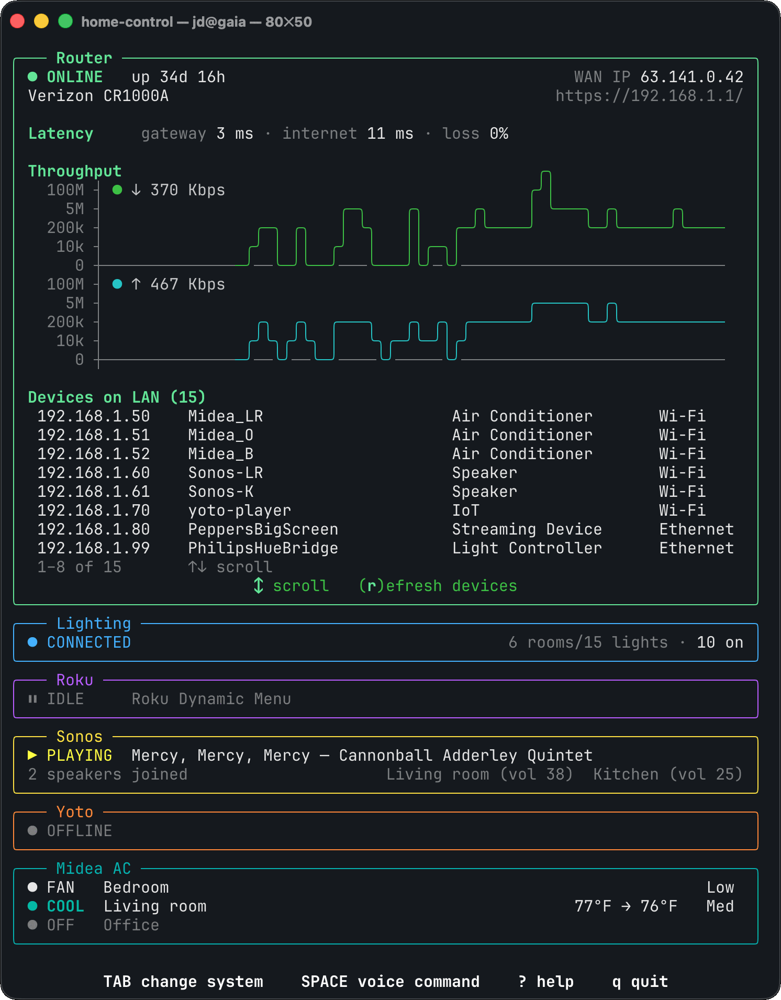

# home-control

A unified interface to control *every* device in your home. *ALL* smart devices
are (potentially) supported: whatever hardware you've got, just ask Claude to
wire it up with the /add-device skill!

Home-control is built to be LAN-first. Each of the built-in modules talks to its
devices directly; no Internet or cloud are required (except a one-time token
retrieval for Midea AC units, see below).

<p align="center">
  
</p>

<!-- Or: 7,000 lines of Python hallucinated by Claude that let me turn my
lights off. -->

To get a feel for the current state of agentic engineering, I built this with
Claude (primarily Opus 4.8/Opus 5) and a self-imposed rule to never look at the
actual code. (I did, however, start Claude off with copies of my standalone
TUIs for Hue lights and Roku.) Claude (`--dangerously-skip-permissions`) had
free rein on a sandbox, with some impressive results:
- Opus one-shot the voice-command mode even without access to an API key for
  testing.
- Opus also managed to reverse engineer the heavily obfuscated login process
  for my router (which I had failed to do a year prior on my own).

Some places Claude fell short:
- Bad-path code was consistently weak: error handling often appeared "locally
  plausible" but wasn't globally reasoned through or tested end-to-end. This
  bites harder for vibe coders since they might live primarily on happy paths,
  never discovering that edge cases and error handling are mucked. For example:
  an audit of disconnection/reconnection handling across four different devices
  ([PR#32](https://github.com/jeremy-dolan/home-control/pull/32)) found gnarly
  bugs in all four. (Notably, three of the six bugs involved naive
  pattern-matching to familiar coding idioms, without checking whether they fit
  the full context.)
- Opus's UI design sense is still very bad. For almost every UI element, I had
  to design it character-by-character. Opus would even routinely misalign
  elements and not notice, despite prudently inspecting screen shots before
  committing. This seems on par with the severely inconsistent results I've
  experienced working with multimodal models' image input.
- Opus was generally unwilling to do basic due diligence on my suggestions and
  would stubbornly commit to them, rather than critique and propose more
  sensible alternatives. When discussion revealed the lurking spaghetti code,
  I had to explicitly push Claude to audit and refactor. A vibe-coder without
  recourse to some basic engineering judgment might get stuck down some very
  bad paths.

## Install

Requires Python 3.12 or newer. The install is editable, so changes to the clone
(say, a device added with /add-device) take effect without reinstalling.

```bash
git clone https://github.com/jeremy-dolan/home-control
cd home-control
python3 -m venv .venv
.venv/bin/pip install -e .
ln -s "$PWD/.venv/bin/home-control" ~/.local/bin/  # or somewhere in your $PATH
```

### Demo

Demo mode, using canned device data (no hardware access):

```bash
ANTHROPIC_API_KEY="" HOME_CONTROL_MOCK=1 home-control
```

### Real use

Run `home-control`. The first run writes a commented config template
to `~/.config/home-control/config.toml` (override with `$HOME_CONTROL_CONFIG`).
Most devices need no config: the router, Roku, Sonos speakers and Midea units
are discovered on the LAN at startup, and their config entries mostly pin IPs
to skip discovery and start faster. Discovered devices are never written back
to the config. What does need setting:

- **Hue** isn't discovered: set `[hue] bridge_ip` (the template's
  `192.168.1.99` is a placeholder). Press the bridge's link button when the
  panel asks; the credential is then cached in `~/.python_hue`.
- **Midea** V3 units need your Midea account in `[midea]` once, to fetch each
  unit's key; keys are cached in `~/.cache/home-control/midea_tokens.json`.
- **Router**: a `[router] password` unlocks the full device list (Fios only).
- **Voice control** (SPACE) needs an Anthropic API key, from
  `ANTHROPIC_API_KEY` or `[voice] api_key`.

Per-device details are under Device support below.

To update, `git pull` in the clone.

### Development

`.venv/bin/pip install -e ".[dev]"` adds the lint, type-check and test tools;
see `ARCHITECTURE.md` for the commands.

## Device support

If you want to use this, you can probably ask Claude to wire in whatever
devices you have. The code is semi-modular (and what is a module anyway?).
Out of the box, home-control supports:

### Router: Verizon Fios CR1000A

Shows WAN health that the router publishes over UPnP (IGD, discovered via
SSDP), no login required: connection status, uptime, public IP, link rates,
and live throughput (sampled from the router's running byte counters). A
separate TCP probe to a public host each poll gives latency and rolling
packet-loss.

The device list has two sources. With a `[router] password` set, it logs into
the router's web interface (custom built for the Verizon Fios CR1000A, SHA-512
challenge auth) and reads the router's device database — friendly names, device
class, and Wi-Fi/Ethernet per device. Without a password it falls back to an
ARP sweep of the local subnet, which sees fewer devices and fewer details.

Config: `[router]` password unlocks the authoritative device list (Fios only);
`router_ip` restricts discovery to one gateway; `igd_url` skips SSDP using a
known descriptor URL; `probe_host` sets the latency/loss target (default
1.1.1.1).

### Media player: Roku

Controls Roku players over ECP (External Control Protocol — HTTP on port 8060):
navigation, playback, app launch, and typing into on-screen text fields. The
player is auto-discovered via SSDP at startup (~3s); if several respond, only
the first is used. ECP reports the foreground app and playback state but not
the media title (Roku doesn't expose it), so the status line names the app, not
the particular content being played.

Keyboard mode forwards each character straight to whatever field the Roku is
currently showing (logins, in-app search). Search mode composes a query locally
and fires it at Roku's global search in one shot.

Config: `[roku] ip` pins the device and skips the SSDP sweep for a quicker
initialization.

### Sound system: Sonos

Controls Sonos speakers through the community-supported SoCo library: play/pause
and transport, volume, grouping, the queue, and your Sonos Favorites. Speakers
are discovered automatically on the LAN. (Local library serving, streaming
service integration, and EQ editing aren't ported yet.)

Config: `[sonos] speakers` pins speakers by IP — each entry is
`{ ip = "...", name = "..." }` — to skip the ~2s SSDP discovery and connect
instantly. The list order is the display order, top to bottom, and the optional
`name` overrides the speaker's own room name. If additional speakers are
broadcast within the same system as the pinned speakers, a popup will alert the
user about additional devices being available. If nothing is pinned in the
config, speakers are auto-discovered and listed alphabetically.

### Lighting: Hue

Controls a Philips Hue bridge via the phue2 library for on/off, brightness,
colour, scenes, and per-room or per-light control, plus direct HTTPS calls to
Hue's CLIP v2 API for the dynamic effects (candle, fire, prism; plain colorloop
is the older v1 API).

Config: `[hue] bridge_ip` points at the bridge. The first connection has to be
authorized by pressing the physical link button on the bridge — the panel will
prompt you — after which the credential is cached and reconnects are automatic.

### HVAC: Midea

Controls Midea air conditioners over their local-LAN protocol via midea-local
(the extracted core of Home Assistant's `midea_ac_lan` integration). Each
connected unit runs its own persistent background thread doing heartbeats and
parsing pushed state updates, so the cards reflect live state with no polling
lag. Units are auto-discovered by LAN broadcast.

`i` opens device info for the selected unit: every attribute and capability the
protocol exposes, including fields the panel never renders (humidity, energy
counters, runtime totals). The regular poll asks only for live status, so
pressing `i` is what queries the unit for the rest.

Config `[midea]`: `units` pins units by IP, allowing us to skip the
broadcast-discovery scan and display the devices instantly. Also allows
assigning each a friendly `name` that overrides the unit's firmware name (e.g.
"net_ac_16A4"). Newer "V3" units require a one-time cloud login to fetch a
per-device token, cached locally afterward so the cloud is only touched once;
set `account` and `password` to your Midea app login, and `cloud` to match which
app it belongs to ("nethome_plus" or "smarthome").

### Yoto

Not implemented yet and cloud API appears required. Placeholder panel with no
backend.
